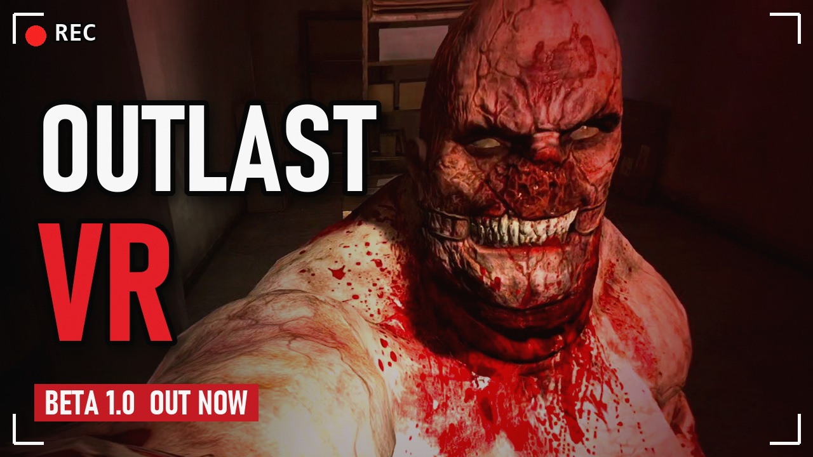
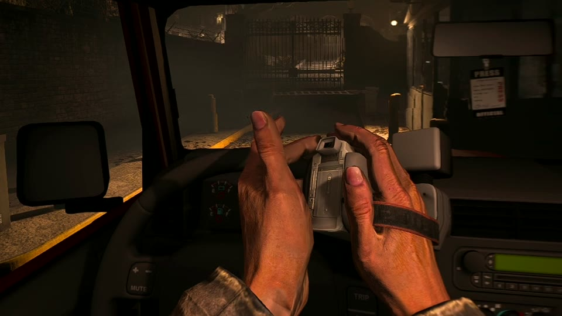
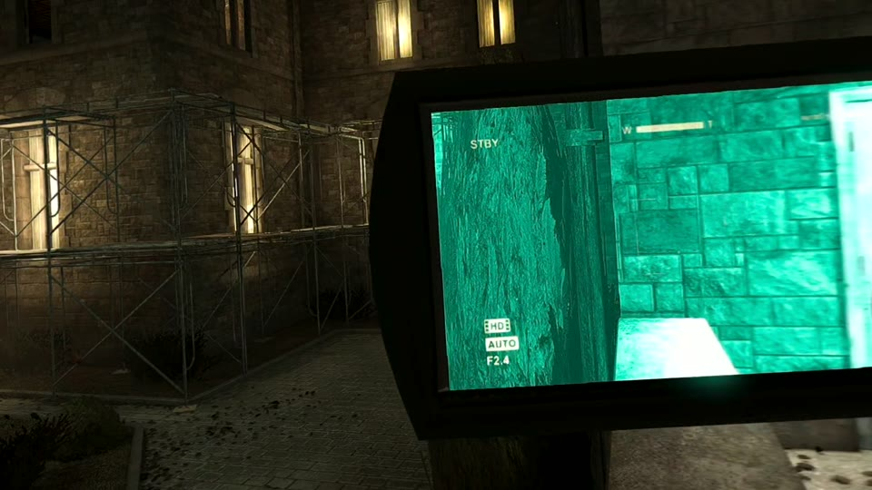
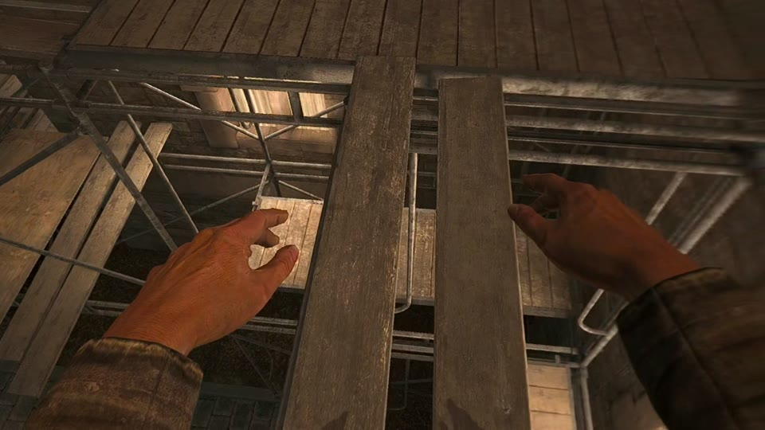
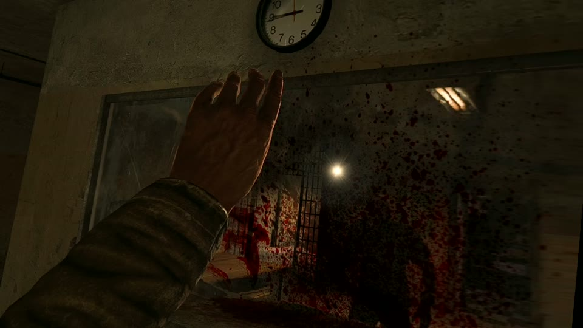
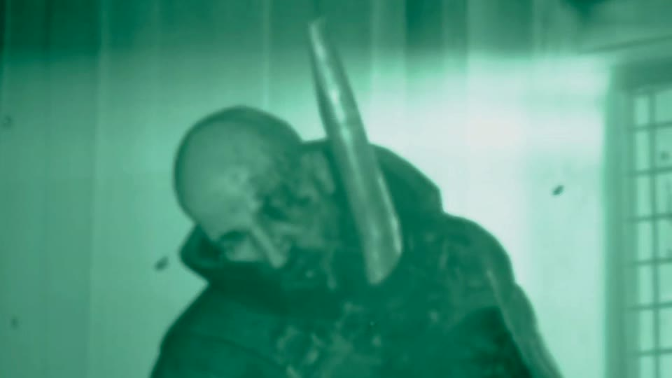
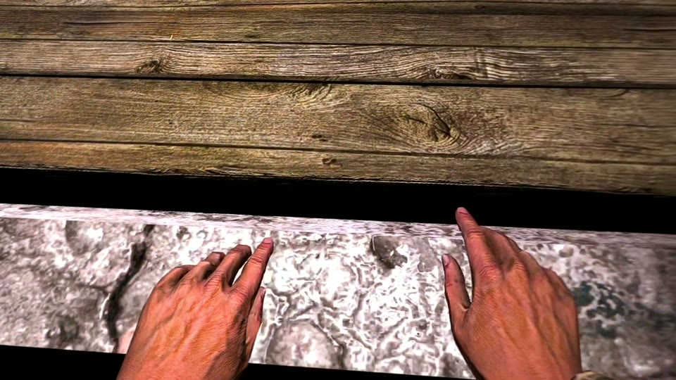
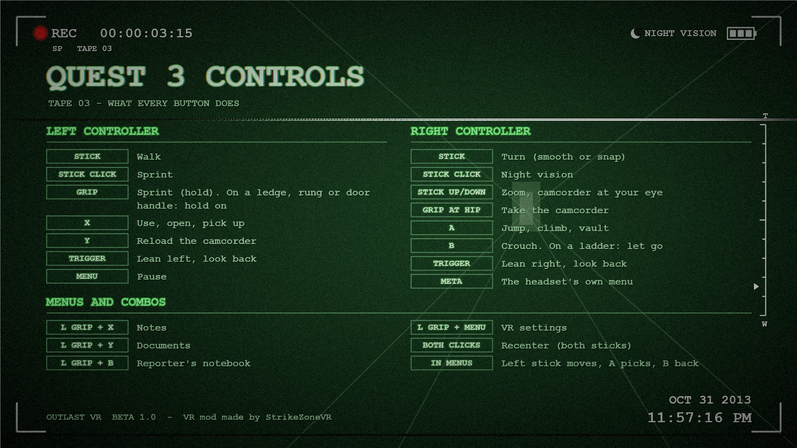

  

<h1 align="center">Outlast VR - Beta 1.1</h1>

  <b>This time, you hold the camera.</b> 
  A free PC VR mod for <i>Outlast</i> (2013) with full head and hand tracking.

  <a href="../../releases/latest"><b>Download Beta 1.1</b></a> &nbsp;|&nbsp;
  <a href="#install">Install</a> &nbsp;|&nbsp;
  <a href="#controls">Controls</a> &nbsp;|&nbsp;
  <a href="../../issues">Report a bug</a> &nbsp;|&nbsp;
  <a href="https://ko-fi.com/strikezonevr">Support on Ko-fi</a>

> **PC VR only.** The game runs on your PC and streams to your headset (SteamVR, Virtual Desktop or
> Quest Link / Air Link). It does **not** run standalone on a Quest.

> **Open for contributors.** The original developer has stepped back, and the full source is here
> under GPL-3.0 for anyone to improve, fix and release. Start with [CONTRIBUTING.md](CONTRIBUTING.md)
> and the open issues in [docs/ROADMAP.md](docs/ROADMAP.md).

---

## What it does

| | |
|---|---|
|  |  |
| **Your hands.** Full head and hand tracking: look and lean with your body, and Miles's arms move with yours. | **Your camera.** The camcorder hangs on your hip. Take it in your hand and raise it to your eye to film, zoom and see in the dark. |
|  |  |
| **Climb hand over hand.** Grab ledges and ladder rungs and pull yourself up. | **Hands on everything.** Push heavy doors open with your hand, or grab the handle and swing them. |
|  |  |
| **See in the dark.** Night vision through the camcorder, battery and all. | **Vault, hide, run.** Vault low walls and tables, hide in lockers, and walk around your room for real: Miles walks with you (room-scale). |

Also included:
- Smooth or snap turning, with a speed you choose.
- Comfort options: keep the horizon level, no head bob, and crouch for real when you duck.
- World size: 100% is true size, with your own eye spacing read from the headset. Lower it if things look too big.
- Your body turns with you: turn your real body or chair and Miles turns to match, so his arms stay lined up.
- A film grain on/off switch.
- VR settings in the launcher and in the game (hold the left grip and press Menu).
- A launcher that installs and uninstalls everything for you.

## What you need

- **Outlast on Steam** (the normal 64-bit game).
- **A PC VR setup:** SteamVR, Virtual Desktop, or Quest Link / Air Link. The mod was made and tested on a
  Meta Quest 3 streaming from the PC through Virtual Desktop. Other OpenXR headsets may work but are untested.
- Run Outlast once normally first, so the game creates its settings files.

## Install

1. [Download the latest release](../../releases/latest) and unzip it.
2. Find your Outlast folder. In Steam, right-click **Outlast**, choose **Manage**, then **Browse local files**,
   and open `Binaries\Win64`.
3. Copy all the files from the zip into that folder, next to `OLGame.exe`.
4. Start your VR runtime (SteamVR, Virtual Desktop or Quest Link) and put the headset on.
5. Run **`Outlast1VR.exe`** and choose **PLAY IN VR**.

Run the launcher again after Steam updates or verifies Outlast, because Steam can reset the game's settings files.

> **"Windows blocked it" in the launcher?** That is Windows ransomware protection (Controlled folder access).
> Allow `Outlast1VR.exe` through it and try again. Running as administrator does not get around it.

## Controls

| Left controller | Right controller |
|---|---|
| Stick: walk | Stick: turn (smooth or snap) |
| Stick click: sprint | Stick click: night vision; hold it: camcorder at your face |
| X: crouch / drop | A: jump, climb, vault |
| Y: reload the camcorder battery | B: use / open / close / pick up |
| Trigger: lean left / look back | Trigger: lean right / look back |
| Menu: pause | Grip at your right hip: take the camcorder |
| Left grip + Menu: **VR settings** | Both stick clicks: recenter |

With the camcorder up, push the right stick straight up or down to zoom.

Hold the right stick click for a moment to raise the camcorder with the game's own animation; it stays
at Miles's face with your hand resting. Hold it again, or squeeze the right grip at your face, to lower
it. A short click stays the night-vision switch.

During gameplay, B uses the left mouse input; keep interaction bound to **Left Mouse Button**
in the game's settings. Menus and the left grip + Menu shortcut keep their original controls.
Set `[Input] MouseUse=0` in `outlastvr.ini` to restore X for use and B for crouch.
The control images above and below show the original layout.

More hand-gesture detail is in [`release/controls/Outlast1VR_Hands_On.png`](release/controls/Outlast1VR_Hands_On.png)
and in the [player README](release/README.txt).

### Manual VR resolution

In the launcher, open **VR SETTINGS > PICTURE**, keep **High-resolution rendering** ON and set
**Eye resolution mode** to **MANUAL**. Drag the **Eye resolution** slider left/right; the pixel
size per eye appears beside it (for example, `2496 x 2688`). Both dimensions scale together,
keeping the saved pair's aspect ratio within 8-pixel rounding. Release to save, then restart.
Arrow keys and the controller D-pad also adjust it. Values stay within 480-4096 per axis. For example,
1440 x 1600 is per eye, not the combined stereo frame. The percentage slider applies only to AUTO.

**AUTO** remains the default: the mod reads the OpenXR runtime's recommended resolution, which
can differ from the physical headset panel resolution. See [launcher instructions](launcher/README.md#choosing-the-vr-render-resolution).

## If something looks wrong

| Problem | Fix |
|---|---|
| The world or your body feels offset | Press both stick clicks to recenter. |
| The picture looks grainy or blurry | VR SETTINGS: turn "Film grain" off. |
| Lamp halos show through walls | Lens flares are suppressed by default. Set `[Render] LensFlares=1` and restart to restore them, including flashlight flares. |
| It stutters | VR SETTINGS: set "Monitor picture" to 30 FPS, and AUTO render resolution to 85-90%, or lower the manual eye dimensions. |
| Textures look wrong, or the game crashes | In `outlastvr.ini`, set `[XR] D3D9Ex=0` (slower, but very compatible). |
| Each eye shows a distorted screen | In `outlastvr.ini`, set `[Render] LensFit=0` (Quest Link does this by itself). |
| The camcorder, doors, climbing or labels get in the way | VR SETTINGS, HANDS: switch any of them off. |

## Reporting a bug

This is a **beta**, so bug reports help a lot. [Open an issue](../../issues/new/choose) and attach:

- your log: `%LOCALAPPDATA%\OutlastVR\OutlastVR_Log.txt` (the launcher's VR SETTINGS has **"Open the log folder"**);
- where in the game it happened, plus a short clip or a description;
- your headset and how you connect it (SteamVR, Virtual Desktop or Quest Link).

## Uninstall

Close Outlast, run `Outlast1VR.exe`, and choose **UNINSTALL VR MOD** (press it twice). It restores the game's
own settings and removes every mod file. The normal game is back.

## Building from source

Visual Studio 2022 with the C++ workload, then `scripts\build.bat`. See [BUILD.md](BUILD.md),
[CONTRIBUTING.md](CONTRIBUTING.md) for a code map and how to test without a headset, and
[docs/TECHNICAL.md](docs/TECHNICAL.md) for how the mod works inside. Open bugs and requests are in
[docs/ROADMAP.md](docs/ROADMAP.md), and the developer change log is in [docs/dev](docs/dev).

## Credits

- **StrikeZoneVR** (StrikeZone Gaming TV): Outlast VR.
- The open-source parts:
  - [MinHook](https://github.com/TsudaKageyu/minhook) (BSD-2-Clause)
  - [Dear ImGui](https://github.com/ocornut/imgui) (MIT)
  - the [Khronos OpenXR loader](https://github.com/KhronosGroup/OpenXR-SDK) (Apache-2.0)

If the mod made Outlast scarier for you, you can [support it on Ko-fi](https://ko-fi.com/strikezonevr). Thank you!

## License

[GPL-3.0](LICENSE). Copyright (C) 2026 the Outlast VR authors.
The vendored libraries keep their own licenses (see `third_party/`).

*Outlast is a game by Red Barrels. This is an unofficial, fan-made mod. It is not affiliated with or endorsed by
Red Barrels, and it does not include any game files. You need your own copy of Outlast.*
